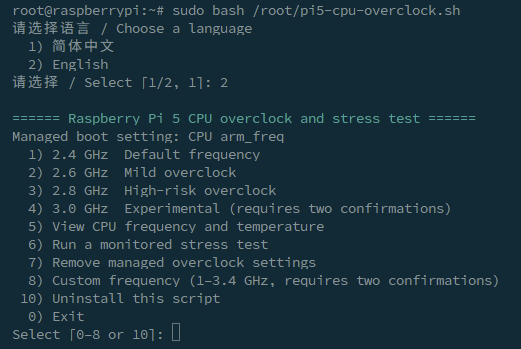
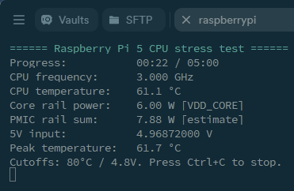

# Raspberry Pi 5 CPU Overclock

CPU frequency control and live stress-test monitoring for Raspberry Pi 5.

[English](#english) · [简体中文](#简体中文) · [Releases](https://github.com/hefan230/pi5-cpu-overclock/releases)

## English

[Requirements](#requirements) · [Setup](#setup) · [Menu](#menu) · [Stress-test safeguards](#stress-test-safeguards) · [Rollback and uninstall](#rollback-and-uninstall)

An interactive CPU overclocking and stress-test tool for Raspberry Pi 5. Choose Simplified Chinese or English at startup, then set a CPU frequency target, inspect live readings, run a stress test, or roll back the managed settings.

> **Overclocking can cause boot failures, crashes, or data loss.** Back up important data and test one step at a time. The **3.0 GHz** preset is experimental, and **3.4 GHz** is the highest custom target the script accepts. Boot and stability depend on the hardware, firmware, and cooling.
>
> **Cooling** · Use a heatsink or an external fan at **2 GHz or higher**. The script recommends a fan at targets of **2.6 GHz or higher**.

### Requirements

- Compatibility testing covers Raspberry Pi 5 only, running Ubuntu 24.04 LTS ARM64 or Raspberry Pi OS.
- Bash 5+ and `sudo` access. The boot partition must be mounted at `/boot/firmware` with a readable and writable `config.txt`.
- Stress testing requires `stress-ng`. PMIC power and input-voltage readings require valid ADC data from `vcgencmd`.

### Setup

Run these commands in a terminal or SSH session on the Pi.

#### 1. Install dependencies

```bash
sudo apt update
sudo apt install stress-ng curl
```

#### 2. Get and run the script

Choose either method to get the script from the [latest GitHub release](https://github.com/hefan230/pi5-cpu-overclock/releases/latest). If you already have the script file, start at step 2 of Option B.

Both methods install the script at `/root/pi5-cpu-overclock.sh` and require `sudo`.

**Option A · Download from GitHub and run**

Paste the entire block into the Pi terminal. It finds the latest release automatically, checks the downloaded script's Bash syntax, and runs it.

```bash
sudo bash -c "$(cat <<'INSTALLER'
  set -e
  repo=hefan230/pi5-cpu-overclock
  cd /root

  download=$(mktemp .pi5-cpu-overclock.XXXXXX)
  trap 'rm -f -- "$download"' EXIT

  if ! curl --proto '=https' -fsL -o "$download" \
    "https://github.com/$repo/releases/latest/download/pi5-cpu-overclock.sh"; then
    release=$(curl --proto '=https' -fsSL "https://api.github.com/repos/$repo/releases/latest")
    url=$(awk 'match($0, /https:\/\/github\.com\/user-attachments\/files\/[0-9]+\/pi5-cpu-overclock\.sh/) {
      print substr($0, RSTART, RLENGTH)
      exit
    }' <<< "$release")
    if [ -z "$url" ]; then
      printf '%s\n' 'The latest release has no pi5-cpu-overclock.sh download.' >&2
      exit 1
    fi
    curl --proto '=https' -fsSL -o "$download" "$url"
  fi

  test -s "$download"
  bash -n "$download"
  mv -fT -- "$download" pi5-cpu-overclock.sh
  bash /root/pi5-cpu-overclock.sh
INSTALLER
)"
```

To reopen the installed script later, run this command.

```bash
sudo bash /root/pi5-cpu-overclock.sh
```

**Option B · Save the script manually and run it**

1. Open the latest GitHub release and download **pi5-cpu-overclock.sh** from the release notes or the **Assets** section.
2. Put the downloaded file in your home directory (`~`) on the Pi, then run these commands to install and start it.

```bash
if [[ ! ~/pi5-cpu-overclock.sh -ef /root/pi5-cpu-overclock.sh ]]; then
  sudo install -m 0600 -- ~/pi5-cpu-overclock.sh /root/pi5-cpu-overclock.sh
fi && sudo bash /root/pi5-cpu-overclock.sh
```

Choose `2` for English or `1` for Simplified Chinese (the default). In the main menu, choose `5` to view CPU frequency and temperature or `6` to set up a stress test.

### Menu



| Option | Action |
| --- | --- |
| `1` | **2.4 GHz** preset |
| `2` | **2.6 GHz** preset |
| `3` | **2.8 GHz** preset |
| `4` | **3.0 GHz** experimental preset. Confirm twice |
| `5` | View CPU frequency and temperature |
| `6` | Run a 1–120 minute stress test. Enter the duration, then confirm with `y` or `Y` |
| `7` | Remove the script-managed overclock settings |
| `8` | Set a custom target from 1 to 3.4 GHz inclusive, with up to three decimal places. Enter `0` to cancel. Writing requires two confirmations |
| `10` | Uninstall the current script |
| `0` | Exit |

Each confirmation accepts a single `y` or `Y`. Press Enter or enter anything else to cancel. Custom targets use GHz. For example, entering `2.625` writes `arm_freq=2625`. Changes apply after reboot, and actual CPU frequency varies with load, temperature, and firmware behavior.

### Stress-test safeguards



A stress test stops at 80 °C, on a temperature read failure, or when the measured 5 V input drops below 4.8 V. The voltage cutoff requires a valid PMIC reading. Reported PMIC power estimates cover the measured rails.

Press `Ctrl+C` to interrupt a test. The script cleans up its temporary files on completion, error exit, or a handled interruption.

### Rollback and uninstall

The script manages `arm_freq` in a dedicated block in `/boot/firmware/config.txt`. Before each rewrite, it saves a copy under `/var/backups/pi5-cpu-overclock/` and prints its path.

- **Roll back**: Choose `7`, confirm, then reboot. Removing the managed block lets the remaining firmware settings determine the CPU frequency.
- **Recover from a boot failure**: Open the boot partition on another computer. In `config.txt`, remove the block between `PI5_CPU_OVERCLOCK_MANAGED_START` and `PI5_CPU_OVERCLOCK_MANAGED_END`, including both marker lines.
- **Uninstall**: Run the script file directly and choose `10`. On confirmation, it removes the managed block and deletes the running script file. The configuration backups are available for recovery.

### Development and tests

Use `test-pi5-cpu-overclock.sh` from the same release. It uses temporary config files and simulated hardware readings to check frequency bounds, both confirmations, backups, write failures, stress-log cleanup, rollback, and uninstall.

```bash
bash -n pi5-cpu-overclock.sh
bash test-pi5-cpu-overclock.sh
```

## 简体中文

[运行环境](#运行环境) · [部署步骤](#部署步骤) · [菜单](#菜单) · [压测保护](#压测保护) · [回滚与卸载](#回滚与卸载)

树莓派 5 的交互式 CPU 超频和压力测试工具。脚本启动时可选简体中文或英文，支持设置 CPU 目标频率、查看实时状态、运行压测和移除超频设置。

> **超频可能导致无法启动、系统崩溃或数据损坏。** 请先备份重要数据，再逐档测试。**3.0 GHz** 预设是实验档，**3.4 GHz** 是脚本接受的自定义目标上限。能否启动并稳定运行取决于硬件、固件和散热。
>
> **散热** · CPU 运行在 **2 GHz 及以上**时，建议配备散热片或外置风扇。目标频率为 **2.6 GHz 及以上**时，脚本会提示安装风扇。

### 运行环境

- 兼容性测试仅覆盖树莓派 5 上的 Ubuntu 24.04 LTS ARM64 和 Raspberry Pi OS。
- Bash 5+，使用 `sudo` 运行。启动分区须挂载到 `/boot/firmware`，且 `config.txt` 可读写。
- 压力测试需要 `stress-ng`。读取 PMIC 功率和输入电压需要 `vcgencmd` 返回有效的 ADC 数据。

### 部署步骤

在树莓派的终端或 SSH 会话中执行以下命令。

#### 1. 安装依赖

```bash
sudo apt update
sudo apt install stress-ng curl
```

#### 2. 获取并运行脚本

以下两种方式任选一种，均从 [GitHub 最新发布](https://github.com/hefan230/pi5-cpu-overclock/releases/latest) 获取脚本。如果手头已有脚本文件，直接从方式 B 的第 2 步开始。

两种方式均使用 `sudo`，默认安装到 `/root/pi5-cpu-overclock.sh`。

**方式 A · 从 GitHub 下载并运行**

把下面整段命令复制到树莓派终端。命令会自动找到最新发布，下载脚本并检查 Bash 语法，检查通过后启动脚本。

```bash
sudo bash -c "$(cat <<'INSTALLER'
  set -e
  repo=hefan230/pi5-cpu-overclock
  cd /root

  download=$(mktemp .pi5-cpu-overclock.XXXXXX)
  trap 'rm -f -- "$download"' EXIT

  if ! curl --proto '=https' -fsL -o "$download" \
    "https://github.com/$repo/releases/latest/download/pi5-cpu-overclock.sh"; then
    release=$(curl --proto '=https' -fsSL "https://api.github.com/repos/$repo/releases/latest")
    url=$(awk 'match($0, /https:\/\/github\.com\/user-attachments\/files\/[0-9]+\/pi5-cpu-overclock\.sh/) {
      print substr($0, RSTART, RLENGTH)
      exit
    }' <<< "$release")
    if [ -z "$url" ]; then
      printf '%s\n' 'The latest release has no pi5-cpu-overclock.sh download.' >&2
      exit 1
    fi
    curl --proto '=https' -fsSL -o "$download" "$url"
  fi

  test -s "$download"
  bash -n "$download"
  mv -fT -- "$download" pi5-cpu-overclock.sh
  bash /root/pi5-cpu-overclock.sh
INSTALLER
)"
```

退出脚本后，可以用下面的命令重新进入。

```bash
sudo bash /root/pi5-cpu-overclock.sh
```

**方式 B · 手动保存后运行**

1. 打开 GitHub 最新发布，从发布说明或 **Assets** 区域下载 **pi5-cpu-overclock.sh**。
2. 将下载的文件放到树莓派当前登录用户的主目录（`~`），然后在终端运行下面的命令安装并启动。

```bash
if [[ ! ~/pi5-cpu-overclock.sh -ef /root/pi5-cpu-overclock.sh ]]; then
  sudo install -m 0600 -- ~/pi5-cpu-overclock.sh /root/pi5-cpu-overclock.sh
fi && sudo bash /root/pi5-cpu-overclock.sh
```

启动时按 `1` 选简体中文（默认），按 `2` 选 English。进入主菜单后可按 `5` 查看 CPU 频率和温度，或按 `6` 开始设置压力测试。

### 菜单


| 选项 | 操作 |
| --- | --- |
| `1` | **2.4 GHz** 预设 |
| `2` | **2.6 GHz** 预设 |
| `3` | **2.8 GHz** 预设 |
| `4` | **3.0 GHz** 实验档，需确认两次 |
| `5` | 查看 CPU 频率和温度 |
| `6` | 运行 1–120 分钟压测。输入时长后，用 `y` 或 `Y` 确认启动 |
| `7` | 移除脚本写入的超频设置 |
| `8` | 自定义 1–3.4 GHz（含端点），最多三位小数。输入 `0` 取消，写入前需确认两次 |
| `10` | 卸载当前脚本 |
| `0` | 退出 |

每次确认均接受单字母 `y` 或 `Y`，直接回车或输入其他内容会取消。自定义频率以 GHz 输入，例如 `2.625`，对应写入 `arm_freq=2625`。配置重启后生效，实际频率会随负载、温度和固件策略变化。

### 压测保护


压测时，CPU 温度达到 80 °C、无法读取温度，或测得 5 V 输入低于 4.8 V，脚本会停止测试。输入电压保护依赖有效的 PMIC 读数。PMIC 功率为所测供电轨的估算值。

按 `Ctrl+C` 可中断压测。脚本会在正常结束、报错退出或处理到中断信号时清理本次生成的临时文件。

### 回滚与卸载

脚本在 `/boot/firmware/config.txt` 的专用区块中管理 `arm_freq`。每次改写前会在 `/var/backups/pi5-cpu-overclock/` 保存原配置，并显示备份路径。

- **撤销超频**：选 `7`，确认后重启。脚本只移除自己管理的区块，频率由剩余的固件配置决定。
- **无法启动**：在另一台电脑上打开启动介质的启动分区，编辑 `config.txt`，删除 `PI5_CPU_OVERCLOCK_MANAGED_START` 与 `PI5_CPU_OVERCLOCK_MANAGED_END` 之间的区块，连同两条标记行一起删除。
- **卸载**：从实际脚本文件运行并选 `10`。确认后，脚本移除管理区块并删除当前运行的脚本文件。配置备份仍可用于恢复。

### 开发与测试

同版本的 `test-pi5-cpu-overclock.sh` 使用临时配置和模拟硬件读数，覆盖频率边界、两次确认、备份、写入失败、压测日志清理、回滚与卸载。

```bash
bash -n pi5-cpu-overclock.sh
bash test-pi5-cpu-overclock.sh
```

## 许可证 / License

GPL-3.0
